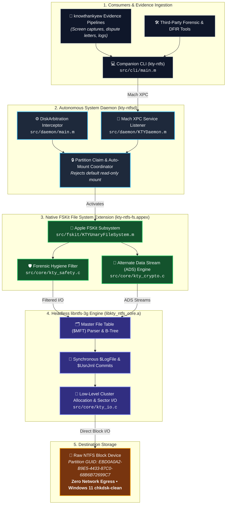

<!-- diagram-meta
  last-validated: 2026-10-26
  validated-commit: a412d77
  covers: [src/**, scripts/**, Makefile, Formula/**]
  generated-by: manual
-->

# Architecture & Invariants Specification: kty-ntfs Storage Engine

> Evidence-grade, native user-space NTFS read/write storage engine, Apple FSKit extension, and autonomous background daemon for macOS.

---

## 1. Overview & Objective

`kty-ntfs` is a native, user-space NTFS read/write storage engine and orchestration layer engineered for macOS 14+ (Sonoma) and macOS 15+ (Sequoia) across Apple Silicon (`arm64`) and Intel (`x86_64`).

Developed within the `knowthankyew` ecosystem, `kty-ntfs` provides a trusted, auditable path for writing evidence, forensic images, memory dumps, and logs to NTFS volumes without compromising host security policies (zero Kernel Extensions, no "Reduced Security" mode) or contaminating destination media with macOS metadata artifacts.

The project is structured as an **autonomous background daemon (`kty-ntfsd`)**, an **Apple FSKit system extension (`kty-ntfs-fs.appex`)**, and a **companion CLI tool (`kty-ntfs`)** usable by any script, forensic pipeline, or manual workflow on the system.

### Portfolio Licensing Distinction & Process Boundary Isolation
While the broader `knowthankyew` portfolio defaults to the permissive **MIT License**, `kty-ntfs` incorporates and statically links against `libntfs-3g` and is licensed under **GPL-2.0-or-later**. To prevent viral GPL contagion into MIT-licensed client engines (`knowthankyew-extension`, `mac-screen-record`, `lease-audit`, etc.), `kty-ntfs` operates strictly across standard operating system process boundaries (CLI, filesystem mounts, and Mach XPC), ensuring total legal and architectural separation.

---

## 2. Core Decisions & Baseline Requirements

* **Target Platforms:** macOS 14.0+ (Sonoma) and macOS 15.0+ (Sequoia). Legacy VFS kext compatibility (Ventura and earlier) is explicitly out of scope.
* **Architecture:** Universal Mach-O (`arm64` + `x86_64`).
* **Security & Sandboxing:** Zero-KEXT. Built entirely on Apple's modern **FSKit** framework. Runs in user space without requiring system reboot or Recovery Mode (1TR) security degradation.
* **Signing Model:** Ad-hoc local code-signing during development and internal testing; prepared for Apple Developer ID + `com.apple.developer.fskit.fsmodule` entitlement upon distribution.
* **Forensic Cleanliness by Default:** The engine intercepts and suppresses OS clutter (`.DS_Store`, `.Spotlight-V100`, `.Trashes`, `.fseventsd`, and AppleDouble `._*` sidecars) by default in volatile memory tombstones.

---

## 3. High-Level System Architecture

### A. System Architecture & Layered Trust Boundary



### B. Mount, Forensic Interception & Write Lifecycle

```mermaid
sequenceDiagram
    autonumber
    actor Host as macOS / Hardware
    participant DA as DiskArbitration
    participant Daemon as kty-ntfsd
    participant FSKit as kty-ntfs-fs.appex
    participant Core as libkty_ntfs_core
    participant Media as NTFS Block Device

    Host->>DA: Connect NTFS USB / NVMe Drive
    DA->>Daemon: DAApprovalCallback (Disk Appeared)
    Daemon->>Daemon: Inspect Partition GUID & Claim Device
    Daemon->>DA: Claim Ownership (Prevent read-only mount)
    Daemon->>FSKit: Load FSKit Resource (FSBlockDeviceResource)
    FSKit->>Core: ntfs_mount(validateBootSector, $MFT)
    Core->>Media: Read Boot Sector & $LogFile
    Core-->>FSKit: Volume Validated (VOLUME_IS_CLEAN)
    FSKit-->>Host: Volume Mounted at /Volumes/<Label>

    alt Host Tries to Write Metadata (.DS_Store / Spotlight)
        Host->>FSKit: createItem(".DS_Store") / write
        FSKit->>FSKit: Intercept & Drop (Volatile RAM Tombstone)
        Note over FSKit: Zero bytes written to NTFS clusters; dirty bit NOT set
        FSKit-->>Host: 0 (Success / No-op)
    else Evidence Payload Write
        Host->>FSKit: writeItem("evidence.mp4", buffer)
        FSKit->>Core: Allocate clusters & write payload
        FSKit->>FSKit: Compute real-time SHA-256 & BLAKE3 hashes
        FSKit->>Core: Write hash to ADS ("evidence.mp4:kty.integrity.blake3")
        Core->>Media: Commit payload clusters + update $LogFile
        FSKit-->>Host: Write Acknowledged
    end

    alt Safe Unmount
        Host->>Daemon: Unmount Request (kty-ntfs unmount)
        Daemon->>FSKit: Flush & Teardown
        FSKit->>Core: ntfs_umount()
        Core->>Media: Flush dirty buffers & clear VOLUME_IS_DIRTY
        Daemon->>DA: Release DiskArbitration Claim & Detach
    end
```

---

## 4. Component Details

### 4.1. Headless `libntfs-3g` Core (`libkty_ntfs_core.a`)
Rather than relying on `ntfs-3g` as an external binary or through `macFUSE`, the low-level NTFS parsing engine is compiled as a standalone static library.

* **Capabilities:**
  * Byte-level parsing of the Master File Table (`$MFT`).
  * B-tree index maintenance for directories.
  * Transaction logging (`$LogFile`) and Update Sequence Number (`$UsnJrnl`) consistency.
  * Support for sparse files, volume dirty bit management, and sector-aligned writes.
* **Modifications from Upstream:**
  * Stripped of all `fuse.h` and POSIX daemon wrappers.
  * Replaced low-level device I/O abstractions (`unix_io`) with direct bridges to macOS `FSBlockDeviceResource` descriptors.
  * Hardened memory allocation policies and boundary checks.

### 4.2. Native FSKit Extension (`kty-ntfs-fs.appex`)
Apple’s modern user-space file system mechanism. It replaces traditional VFS kernel extensions and provides a standardized API for block-device filesystems.

* **Protocols Implemented:**
  * `FSUnaryFileSystem`: Handles single-volume mounting lifecycle.
  * `FSUnaryFileSystemOperations`: Resource probing (`probeResource`), loading, and unloading.
  * `FSVolumeOperations`: Inode lookups, file creation, item removal, and volume metadata.
  * `FSVolumeReadWriteOperations`: File data reading, cluster allocation, writes, and cache sync.
  * `FSVolumeXattrOperations`: Extended attributes translation to NTFS Alternate Data Streams (ADS).
  * `FSVolumeRenameOperations`: Safe item rename and atomic directory restructuring.

### 4.3. Forensic Hygiene & Policy Engine
In digital evidence preservation, writing to a destination disk must not inadvertently modify timestamps, create arbitrary system files, or leave corrupt transaction states.

1. **System Metadata Suppression (Default ON):**
   * Drops requests from Finder or Spotlight to write `.DS_Store`, `.Spotlight-V100`, `.fseventsd`, and `.Trashes`.
   * When enabled, Finder cannot litter the root directory of the destination volume.
   * If disabled via `--allow-system-metadata`, `kty-ntfs` logs a high-severity warning indicating that the volume is receiving non-forensic host modifications.
2. **Alternate Data Stream (ADS) Mapping:**
   * macOS extended attributes (`xattr`) like quarantine tags or file flags are mapped natively to NTFS Alternate Data Streams (`filename:streamname`) instead of generating `._filename` (AppleDouble) sidecar files.
3. **Cryptographic Chain-of-Custody Integrity:**
   * Automatic SHA-256 and BLAKE3 tree hashes calculated in real time and stored in Alternate Data Streams (`filename:kty.integrity.sha256` and `filename:kty.integrity.blake3`).

---

## 5. Core Architectural Invariants

| # | Invariant | Description & Enforcement |
|:--|:----------|:--------------------------|
| 1 | **Zero Network Egress** | Statically verified to contain zero networking symbols, BSD sockets, or external telemetry (`nm -u` clean; enforced by `scripts/audit-claims.py`). |
| 2 | **Zero Kernel Extensions (Zero-KEXT)** | 100% user-space FSKit architecture. No macOS System Integrity Protection (SIP) degradation or "Reduced Security" mode required. |
| 3 | **Forensic Hygiene by Default** | Volatile RAM tombstones intercept and drop `.DS_Store`, `.Spotlight-V100`, `.Trashes`, and `._*` files without allocating disk clusters or toggling the dirty bit. |
| 4 | **Cross-Platform chkdsk Cleanliness** | Volumes unmounted by `kty-ntfs` mount cleanly on Windows 10/11 with zero dirty flags, transaction corruption, or "Scan and fix" dialogs. |
| 5 | **Strict Process-Boundary GPL Isolation** | `kty-ntfs` statically links `libntfs-3g` (GPL-2.0-or-later) and isolates strictly across XPC, CLI, and filesystem mount boundaries, preventing GPL contagion into MIT sibling apps. |

---

## 6. Directory Structure

```
kty-ntfs/
├── Makefile                     # Universal multi-target build (arm64 + x86_64)
├── Formula/
│   └── kty-ntfs.rb              # Homebrew distribution formula
├── docs/
│   ├── ARCHITECTURE.md          # Architecture, data flow & invariant specification
│   ├── OPERATIONS.md            # Operational runbook & troubleshooting
│   ├── ROADMAP.md               # 8-phase roadmap to Apple Developer ID
│   └── WINDOWS_VALIDATION.md    # Windows 11 cross-validation procedure
├── scripts/
│   ├── audit-claims.py          # Metadata, licensing & zero-egress linter
│   ├── codesign-adhoc.sh        # Local ad-hoc code signing runner
│   ├── create-self-signed-cert.sh # Local self-signed identity generator
│   ├── install.sh / uninstall.sh # System service lifecycle installers
│   └── verify-windows.ps1       # Windows PowerShell test suite
├── src/
│   ├── cli/                     # kty-ntfs CLI source (main.m)
│   ├── daemon/                  # kty-ntfsd LaunchDaemon (KTYDaemon.m, Mach XPC)
│   ├── fskit/                   # kty-ntfs-fs.appex FSKit extension (KTYVolume.m)
│   └── core/                    # libkty_ntfs_core (C engine, I/O, crypto)
└── tests/                       # C and Objective-C unit & torture suites
```
